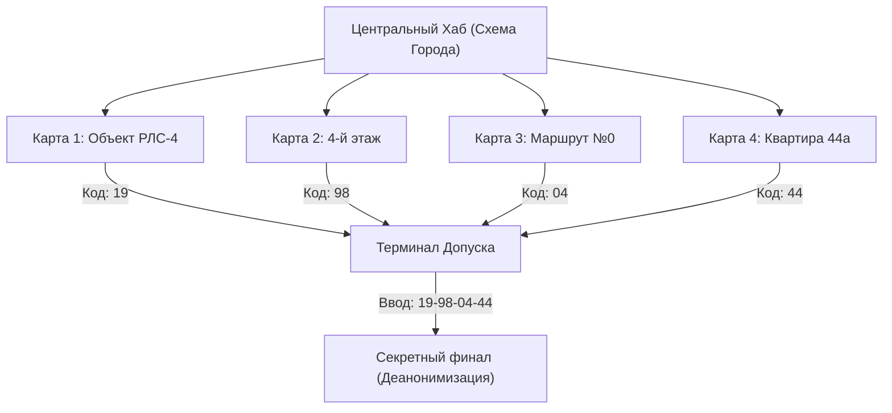

# 📘 РУКОВОДСТВО ПО ЗАПУСКУ И ЭКСПЛУАТАЦИИ ПРОЕКТА «КОНТУР»

> **Версия документа:** 1.0.0  
> **Статус:** Production Ready  
> **Кодовое имя:** «ГорСветТехКонтроль // Служебный Узел-70»

---

## 1. Введение и концепция проекта

### 1.1. О проекте
**«КОНТУР»** — веб-приложение в жанре интерактивного аналогового расследования и психологического техно-хоррора. Интерфейс выполнен в виде терминала советско-постсоветской диспетчерской службы северного моногорода — организации «ГорСветТехКонтроль». 

Игрок перехватывает незашифрованную ночную сессию дежурного оператора. Исследуя город через интерактивную схему районов, видеокамеры низкого разрешения, архивы и перехваты радиочастот, игрок раскрывает цепочку связанных аномалий 1998 года.

### 1.2. Ключевые принципы реализации
- **Zero Asset Bloat (Нулевая нагрузка на трафик)**: Все звуки (гул трансформатора, треск счетчиков, помехи радио, щелчки тумблеров, инфразвуковые удары) генерируются в реальном времени через **Web Audio API** без внешних тяжелых MP3/WAV файлов. Сборка весит менее 400 Кб.
- **Аналоговая эстетика (CRT / Scanlines)**: Настоящие строчные развертки, виньетирование, искажения люминофора и микроглитчи реализованы на чистом аппаратном CSS.
- **Интерактивный темп (Пейсинг 60–90 секунд)**: Каждая карта требует активной смены фокуса (чтение логов \rightarrow настройка сенсоров \rightarrow поиск в базе данных \rightarrow решение загадки \rightarrow предотвращение критического сбоя по таймеру).

---

## 2. Системные требования

### 2.1. Требования к серверу / среде сборки
- **Node.js**: `v18.0.0` или выше (протестировано на Node.js v20.x и v22.x LTS).
- **Пакетный менеджер**: `npm` (v9+), `pnpm` (v8+) или `yarn` (v1.22+).
- **ОС**: macOS, Linux (Ubuntu 20.04+, Debian, Alpine), Windows 10/11 (WSL2 / PowerShell).

### 2.2. Требования к клиентскому браузеру
- **Десктоп**: Google Chrome 90+, Mozilla Firefox 88+, Apple Safari 15+, Microsoft Edge 90+.
- **Мобильные устройства**: iOS Safari 15+, Chrome Mobile 90+ (поддерживается адаптивный режим просмотра).
- **Обязательные Web API**:
  - `AudioContext` / `webkitAudioContext` (для аудиосинтезатора).
  - `localStorage` (для автосохранения прогресса).
  - `CSS Grid` & `Flexbox` с поддержкой аппаратного ускорения CSS-фильтров.

---

## 3. Локальный запуск и разработка

### 3.1. Установка зависимостей
Склонируйте репозиторий и установите пакеты:
```bash
git clone https://github.com/your-org/kontur.git
cd kontur
npm install
```

### 3.2. Доступные npm-скрипты

| Команда | Описание |
| :--- | :--- |
| `npm run dev` | Запуск локального dev-сервера с HMR (Hot Module Replacement) на порту 5173. |
| `npm run build` | Запуск компилятора TypeScript (`tsc --noEmit`) и последующая продакшн-сборка в папку `dist/`. |
| `npm run preview` | Локальный запуск production-сборки из папки `dist/` для финальной проверки перед деплоем. |
| `npm run typecheck` | Строгая проверка типов всего проекта без генерации файлов. |

### 3.3. Локальный запуск dev-сервера
```bash
npm run dev
```
В терминале отобразится адрес:
```text
  VITE v6.0.0  ready in 180 ms

  ➜  Local:   http://localhost:5173/
  ➜  Network: use --host to expose
```
Откройте [http://localhost:5173](http://localhost:5173) в браузере.

---

## 4. Архитектура проекта и компонентов

```
kontur/
├── src/
│   ├── audio/
│   │   └── soundEngine.ts         # Синтезатор звука на Web Audio API
│   ├── components/
│   │   ├── Header.tsx             # Шапка: таймер, сессия, тумблеры звука и ЭЛТ
│   │   ├── Hub.tsx                # Центральная интерактивная карта и терминал
│   │   ├── MapRLS4.tsx            # Карта 1: Бункер РЛС-4 (шлюз В-2, камера, база)
│   │   ├── MapFloor4.tsx          # Карта 2: 4-й этаж (смартфон, чат ЖК, ТСЖ)
│   │   ├── MapRoute0.tsx          # Карта 3: Маршрут №0 (архив депо, радио, чистильщик)
│   │   ├── MapApt44.tsx           # Карта 4: Квартира 44а (пульт инженера, звонок, Устав)
│   │   └── SecretEnding.tsx       # Секретный финал (считывание телеметрии игрока)
│   ├── styles/
│   │   └── index.css              # CRT-фильтры, строчные развертки, палитра терминала
│   ├── types/
│   │   └── index.ts               # Типы: экраны, прогресс, логи, инциденты
│   ├── App.tsx                    # Главный контроллер: роутер экранов, хранилище
│   └── main.tsx                   # Точка входа ReactDOM
```

### 4.1. Управление состоянием (`GameProgress`)
Состояние хранится в `App.tsx` и автоматически синхронизируется с `localStorage` по ключу `kontur_game_progress_v1`:

```typescript
export interface GameProgress {
  rls4Solved: boolean;       // Карта 1 решена
  floor4Solved: boolean;     // Карта 2 решена
  route0Solved: boolean;     // Карта 3 решена
  apt44Solved: boolean;      // Карта 4 решена
  codes: {
    rls4: string;            // '19'
    floor4: string;          // '98'
    route0: string;          // '04'
    apt44: string;           // '44'
  };
  terminalInput: [string, string, string, string]; // Ввод в 4 слота терминала
  secretUnlocked: boolean;   // Допуск к финалу получен
  soundEnabled: boolean;     // Статус звука
}
```

### 4.2. Звуковой движок (`soundEngine.ts`)
Браузеры блокируют воспроизведение звука до первого действия пользователя (User Gesture). Движок учитывает эту политику:
- `AudioContext` создается и переводится в состояние `running` при первом клике на любую кнопку.
- В шапке предусмотрен явный тумблер **«ЗВУК: ВКЛ / ВЫКЛ»**.
- Все спецэффекты генерируются осцилляторами (`OscillatorNode`), фильтрами частот (`BiquadFilterNode`) и генераторами шума (`AudioBufferSourceNode`).

---

## 5. Спецификация 4 карт и финала



### 5.1. Карта 1: «Объект РЛС-4»
- **Логика**: Камера видеонаблюдения шлюза В-2 в темноте.
- **Действие**: Регулировка ползунка ИК-подсветки/чувствительности.
- **Находка**: За спинами 11 фигур на стене начертано мелом: `714`. Двенадцатый труп — дежурный Соколов.
- **Проверка базы**: Ввод `714` в картотеку показывает остановку сердца Соколова 45 минут назад. Человек в чате — самозванец.
- **Кульминация**: Таймер 40 секунд. Запуск системы экстренной заморозки сектора с кодом `714`.
- **Итоговый код сектора**: `[ 19 ]`.

### 5.2. Карта 2: «4-й этаж»
- **Логика**: Найденный смартфон с чатом «ЖК Лесной» и галереей.
- **Действие**: 
  - Прослушивание голосового шепота Светланы из ванной.
  - Анализ ночного фото фасада: выкручивание контраста (>65%) и зума (>140%) обнаруживает прижатый к стеклу номер Л/С `8804`.
  - Подсчет окон фасада: на 4 этаже единственная темная квартира — `38`.
- **Кульминация**: Сообщение от всех 64 жильцов одновременно. Игнорирование запроса доступа к камере и выжигание реле в приложении ТСЖ (счет `8804`, квартира `38`).
- **Итоговый код сектора**: `[ 98 ]`.

### 5.3. Карта 3: «Маршрут №0»
- **Логика**: Электронный архив трамвайного депо за 1998 год.
- **Динамика**: Бот `[ID: ЧИСТИЛЬЩИК]` в реальном времени форматирует диск и удаляет дела.
- **Действие**:
  - Нахождение частоты `104.2 FM` в путевом листе водителя Соколова (того самого из Карты 1).
  - Настройка радиосканера ровно на `104.2 МГц` и расшифровка черного ящика вагона №314.
  - Получение кода аварийного сброса диспетчера: `3140`.
- **Кульминация**: Чистильщик перехватывает ввод. В консоли вводится код `3140`, разрывающий связь сталкера. Рассекречивается фото котлована с замурованным в бетон трамваем.
- **Итоговый код сектора**: `[ 04 ]`.

### 5.4. Карта 4: «Квартира 44а»
- **Логика**: Рабочий стол главного инженера «ГорСветТехКонтроля».
- **Динамика**: Таймер 10 минут до разрушения стены автоматической буровой установкой.
- **Действие**:
  - Изучение служебной записки слесаря о голосах и акта БТИ с бесконечной площадью квартиры.
  - Звонок начальнику участка по внутреннему телефону: сущность имитирует голоса погибших и требует подтвердить снос по фальшивому «Нормативу 112».
  - Сверка с Уставом спецконтроля: разоблачение сущности и выставление в электронном наряде статуса **«КАРАНТИН БЕЗ СРОКА ДАВНОСТИ»**.
- **Итоговый код сектора**: `[ 44 ]`.

### 5.5. Секретный Финал
- **Вход**: Ввод кода `19 - 98 - 04 - 44` в Терминал Допуска на главной карте.
- **События**:
  - Янтарная подсветка отключается, запускается низкий гул промышленного трансформатора.
  - Открывается досье «ЛИЧНОЕ ДЕЛО ОПЕРАТОРА» со считыванием реальных параметров системы игрока (время, таймзона, ОС, разрешение экрана).
  - На схеме города появляется 5-я тревожная точка прямо по центру:  
    *«ВАШЕ ТЕКУЩЕЕ МЕСТОПОЛОЖЕНИЕ. ДАТЧИК ПРИСУТСТВИЯ: 2 ЧЕЛОВЕКА».*

---

## 6. Развертывание в продакшн (Deployment)

### 6.1. Деплой на Vercel
1. Установите CLI или свяжите GitHub-репозиторий в панели Vercel:
   ```bash
   npx vercel
   ```
2. Параметры развертывания:
   - **Framework Preset**: `Vite`
   - **Build Command**: `npm run build`
   - **Output Directory**: `dist`
   - **Install Command**: `npm install`
3. Vercel автоматически раздаст статику через глобальный Edge CDN с поддержкой HTTP/2 и Brotli-сжатия.

### 6.2. Деплой через Docker и Nginx
Для закрытых контуров или собственных серверов подготовлен сценарий контейнеризации:

**Dockerfile:**
```dockerfile
# Сборка
FROM node:20-alpine AS builder
WORKDIR /app
COPY package*.json ./
RUN npm ci
COPY . .
RUN npm run build

# Раздача через Nginx
FROM nginx:alpine
COPY --from=builder /app/dist /usr/share/nginx/html
COPY nginx.conf /etc/nginx/conf.d/default.conf
EXPOSE 80
CMD ["nginx", "-g", "daemon off;"]
```

**nginx.conf:**
```nginx
server {
    listen 80;
    server_name localhost;
    root /usr/share/nginx/html;
    index index.html;

    # Сжатие gzip
    gzip on;
    gzip_types text/plain text/css application/json application/javascript text/xml application/xml;

    location / {
        try_files $uri $uri/ /index.html;
    }

    # Кеширование ассетов
    location ~* \.(?:css|js|woff2?|svg|png|jpg|ico)$ {
        expires 1y;
        add_header Cache-Control "public, max-age=31536000, immutable";
    }
}
```

Сборка и запуск контейнера:
```bash
docker build -t kontur:latest .
docker run -d -p 8080:80 --name kontur-game kontur:latest
```
Приложение станет доступно на `http://localhost:8080`.

---

## 7. Чеклист готовности к релизу (Production Checklist)

- [x] **Проверка типов TypeScript**: `npm run typecheck` завершается с кодом 0 без ошибок.
- [x] **Проверка сборки Vite**: `npm run build` успешно формирует бандл в папке `dist/`.
- [x] **Звуковой движок Web Audio API**:
  - [x] Отсутствие крашей при запуске в режиме автоплея без жеста пользователя.
  - [x] Плавный пуск и остановка трансформаторного фона (`startTransformerHum` / `stopTransformerHum`).
  - [x] Работоспособность тумблера отключения звука в шапке.
- [x] **ЭЛТ-фильтры (CRT)**:
  - [x] Корректное отображение сканлайнов и виньетки на мониторах разного разрешения.
  - [x] Кнопка отключения ЭЛТ в шапке для игроков с чувствительным зрением.
- [x] **Сохранение прогресса**:
  - [x] Прогресс прохождения 4 карт сохраняется в `localStorage` и восстанавливается при F5.
  - [x] Доступна кнопка полного сброса сессии в секретном финале.
- [x] **Кроссбраузерность**:
  - [x] Chrome / Chromium (полная поддержка).
  - [x] Safari macOS / iOS (корректная обработка префиксов `webkitAudioContext`).
  - [x] Firefox (корректный рендеринг SVG-сетки и фильтров).

---

## 8. Мониторинг и эксплуатация

Поскольку проект является клиентским статическим SPA без обязательного серверного бэкенда:
- Все вычисления производятся в браузере клиента.
- Серверная нагрузка минимальна (раздача HTML, JS, CSS).
- Риск отказа БД равен нулю.
- Для мониторинга ошибок JavaScript в продакшне рекомендуется подключение **Sentry** или **LogRocket** на уровне `main.tsx`.

---
*Документация утверждена инженерно-техническим отделом «ГорСветТехКонтроль».*
